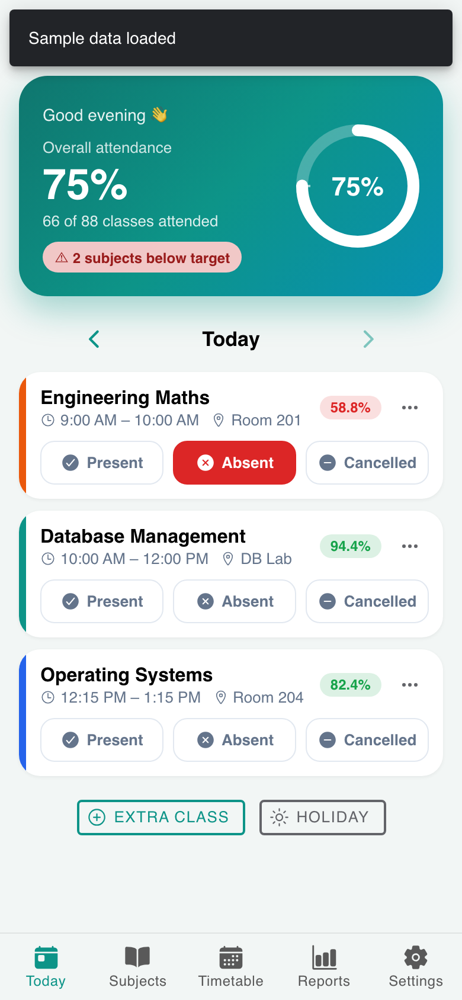
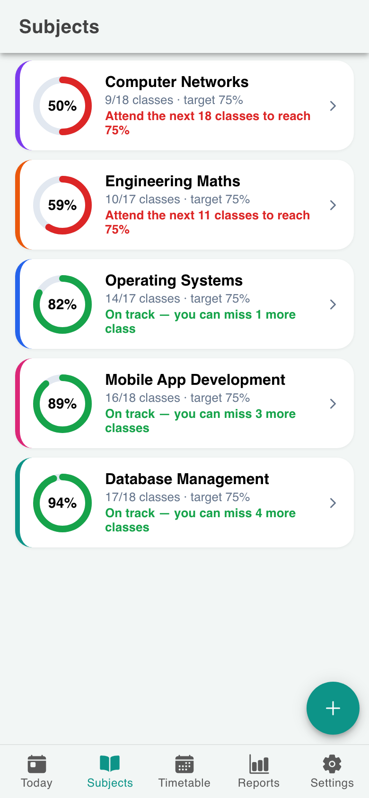
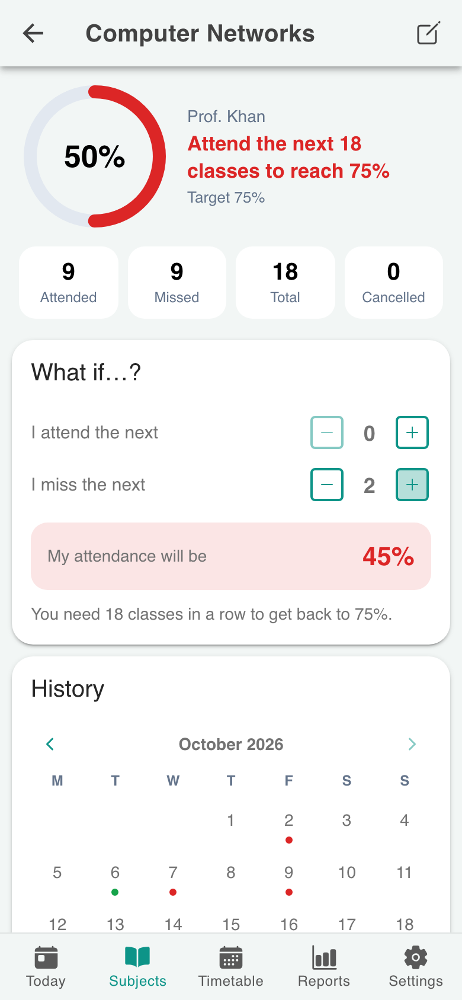
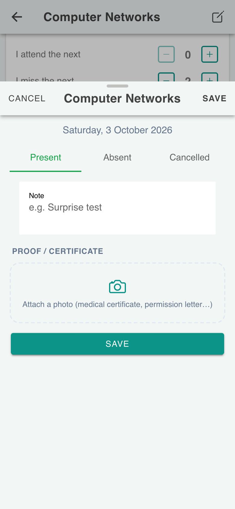
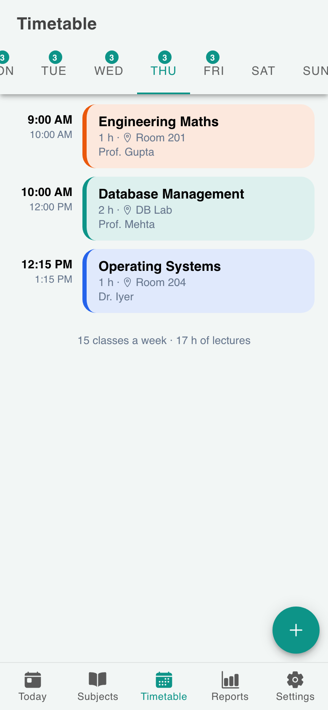
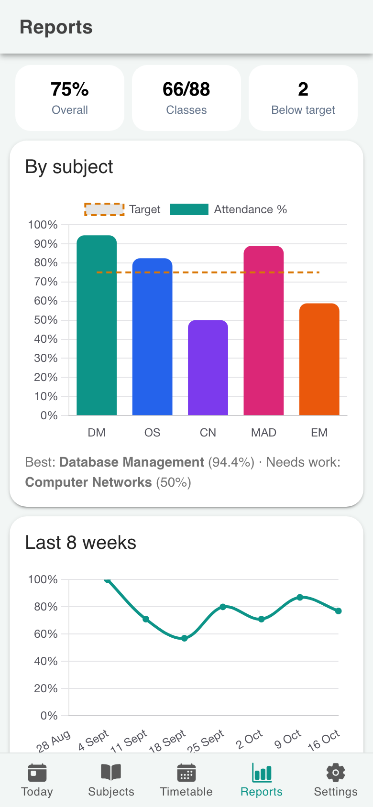
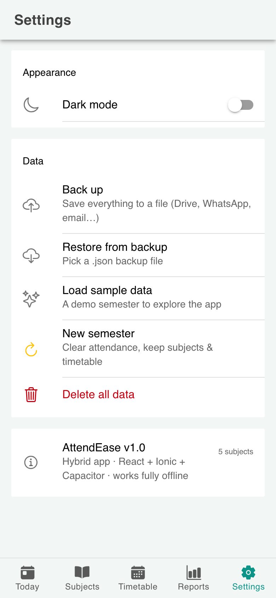
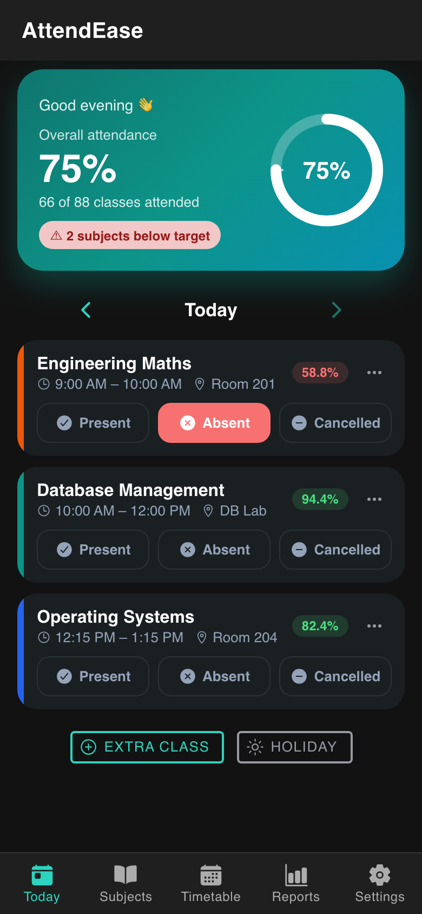

# AttendEase — Attendance Tracker (Hybrid Mobile App)

AttendEase helps students track attendance for every subject. It shows exactly **how many classes you can still miss**, or **how many you must attend** to reach the required percentage (e.g. 75%).
It is built once as a **web application** (React + Ionic) and packaged as a native **Android app** with **Capacitor** (the hybrid approach). It works **fully offline**.

> **APK:** [`release/AttendEase.apk`](release/AttendEase.apk)

| Today | Subjects | Subject details | Mark / proof |
|---|---|---|---|
|  |  |  |  |

| Timetable | Reports | Settings | Dark mode |
|---|---|---|---|
|  |  |  |  |

## Features

- **Today screen**: today's classes from your timetable. Mark each one with a single tap: **Present / Absent / Cancelled**. Includes the overall attendance ring and the next class with a countdown.
- **Mark from the notification**: after each class, a notification asks *"Did you attend DBMS?"* with **Present / Absent / Cancelled** buttons, so you never have to open the app.
- **Class reminders**: a notification 5, 10, 15 or 30 minutes before each class, showing the room number.
- **Smart calculator**:
  - "On track — you can miss 3 more classes"
  - "Attend the next 5 classes to reach 75%"
  - **What-if mode**: "If I miss the next 2 classes, my attendance will be 72%"
- **Subjects**: own colour, teacher name, required % per subject, and starting counts if you begin mid-semester
- **Weekly timetable**: day-wise schedule with room numbers and clash detection
- **History calendar**: colour-coded days per subject. Tap any past day to add or edit a mark.
- **Proof photos**: attach a medical certificate or permission letter to an absence with the camera or gallery
- **Extra classes and holidays**: log an extra lecture, or mark a whole day as a holiday in one tap
- **Reports**: bar chart by subject against the target line, an 8-week trend, and **PDF and CSV export** you can share on WhatsApp, Gmail or Drive
- **Backup and restore** to a JSON file, **new semester** reset, **sample data** for a quick demo, and **dark mode**

## Hybrid architecture

```
┌────────────────────────────────────────────────┐
│  React + Ionic UI  (HTML / CSS / JavaScript)   │  ← same code runs in the browser
├────────────────────────────────────────────────┤
│  Capacitor bridge  (JS ⇄ native Android code)  │
├────────────────────────────────────────────────┤
│  Android WebView + native plugins              │
│  Preferences · Notifications (with actions)    │
│  Camera · Filesystem · Share · Haptics · …     │
└────────────────────────────────────────────────┘
```

| Native feature | Capacitor plugin | Used for |
|---|---|---|
| Key-value storage | `@capacitor/preferences` | Subjects, timetable, attendance and settings, stored offline as JSON (Android SharedPreferences) |
| Local notifications **with action buttons** | `@capacitor/local-notifications` | Weekly class reminders and the post-class "Present / Absent" prompt |
| Camera / gallery | `@capacitor/camera` | Proof photos such as medical certificates |
| File system | `@capacitor/filesystem` | Storing photos privately, writing PDF/CSV/backup files |
| Share sheet | `@capacitor/share` | Sending reports and backups to other apps |
| Haptics | `@capacitor/haptics` | Vibration feedback, warning when a subject drops below target |
| Status bar / splash screen | `@capacitor/status-bar`, `@capacitor/splash-screen` | Native look and feel |
| App | `@capacitor/app` | Android hardware back button |

## The attendance formulas

Let `A` be classes attended, `T` classes held, and `t` the target (0.75 for 75%).

```
Classes you must attend in a row:  x ≥ (t·T − A) / (1 − t)     →  ceil
Classes you can still miss:        y ≤ (A − t·T) / t           →  floor
Projected %:                       (A + attend) / (T + attend + miss)
```

Example: 20 of 25 attended (80%), target 75% gives `(20 − 18.75) / 0.75 = 1.67`, so **you can miss 1 class**.
Cancelled classes don't count towards `T`. See `src/services/attendance.js`.

## Data model

```js
Subject  { id, name, teacher, color, target, initialAttended, initialTotal }
Slot     { id, subjectId, day (0=Sun…6=Sat), start "09:00", end "10:00", room }
Record   { id, subjectId, slotId | null, date "2026-10-22", status, note, photo?, extra? }
Settings { studentName, defaultTarget, reminderEnabled, reminderMinutes, postClassPrompt, darkMode }
```

Percentages are always **calculated from the records**, never stored, so editing a past mark updates every screen automatically.

## Tech stack

React 19 · Ionic React 9 · React Router 6 · Capacitor 8 · Chart.js · jsPDF · Vite

## Project structure

```
src/
├── App.jsx                     Tabs and routes
├── context/DataContext.jsx     App state, persistence, notification sync
├── services/
│   ├── attendance.js           Percentage, "can miss", "need to attend", projections
│   ├── storage.js              Capacitor Preferences, backup format
│   ├── notifications.js        Weekly reminders and actionable post-class prompts
│   ├── native.js               Camera, filesystem, share, haptics, status bar
│   ├── reports.js              PDF (jsPDF) and CSV export
│   └── sample.js               Demo semester data
├── components/                 ProgressRing, AttendanceCalendar, RecordSheet, SubjectForm, SlotForm
├── pages/                      Today, Subjects, SubjectDetail, Timetable, Reports, Settings
└── theme/                      Colours (light/dark) and styles
android/                        Native Android project generated by Capacitor
```

## Run and build

**Requirements:** Node 20+, Android Studio (Android SDK), JDK 21

```bash
npm install
npm run dev          # web version at http://localhost:5173
npm run apk          # build web → sync to Android → release/AttendEase.apk
npm run android      # open the project in Android Studio
```

When you build from Android Studio, set **Settings → Build Tools → Gradle → Gradle JDK** to a JDK 21.

**Quick demo:** open the app, tap **Try with sample data**, and you get a full semester with five subjects, a timetable and six weeks of history.
